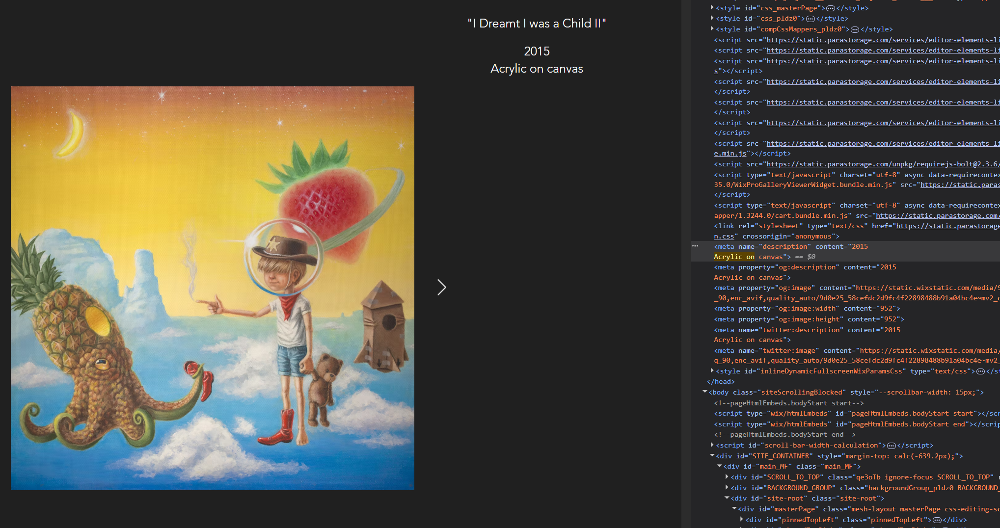

# POCTF 2026 — Strings Attached

OSINT3
## Strings Attached

## Challenge Page Description:

### Michael Romaniello
I love ttrpgs. Sort of. I'll explain.

I like the games. I hate people. Dirty, smelly, awful things best kept far away lest they attempt some act of violence against you. Like robbing you. Or chatting at the bus stop.

As a kid, ttrpgs kick-started my imagination. I started building stories and maps and characters. It was the perfect retreat for a kid that was always half-in and half-out of his own head anyway.

Even today, I remain inspired by how these games can provide respite and bring out creative energies that are otherwise so often repressed for the sake of the dull task at hand. Our subject today is an excellent example, I feel. And as someone that has read every monster manual from AD&D to 5.5, there is NOTHING more powerful than a wizard with a gun.

Remember, for these you are looking for the ANSWER to the question(s) below.**

The question on the https://pointeroverflowctf.com/challenges/strings-attached/ page is "In what year was 'I Dreamt I was a Child II' completed?"
After submitting the year from the following solution, you get the flag.

## Solution

1. Search for Michael Romaniello’s (the title on the challenge page) art and find https://www.michaelromaniello.com/portfolio which matches the fine artist and illustrator.
2. Open the hamburger menu on the top right to the Portfolio page.
3. Go through the different artworks and find the exact title **“I Dreamt I was a Child II”** in the portfolio. Its gallery description is **“2015\nAcrylic on canvas”**. The first line gives the artwork’s year: **2015**.

